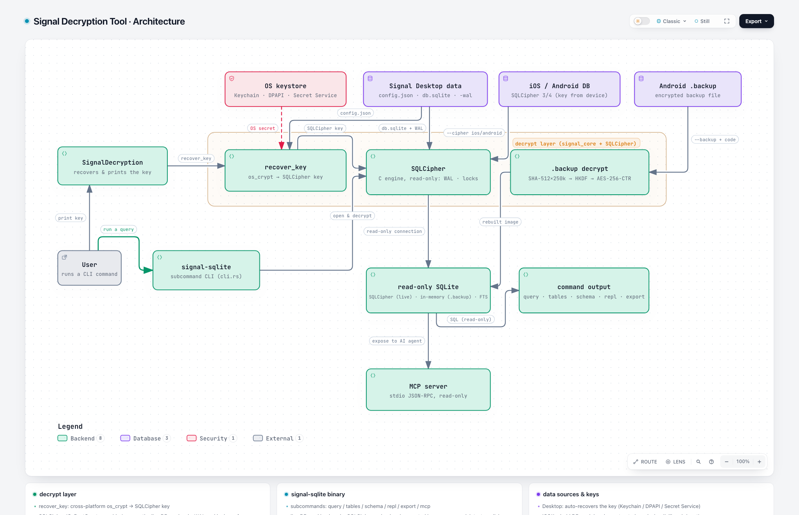

# Signal Decryption Tool for macOS 🔐

English | [中文](README_zh.md)

## Overview 🌟

This project provides two Rust command-line tools for **macOS, Windows and Linux**:

- **`SignalDecryption`** — recovers Signal Desktop's SQLCipher database key from its encrypted configuration.
- **`signal-sqlite`** — opens Signal's encrypted database with the automatically recovered key and lets you run SQL directly, so you never handle the key yourself. It opens the database with **SQLCipher itself**, read-only, the same engine Signal uses, so the WAL, locking and checkpoints behave exactly as for Signal's own readers. See [Querying the database](#querying-the-database-signal-sqlite-).

Both share a `signal_core` library that recovers the key by implementing Chromium's `os_crypt` scheme, which differs per platform:

- **macOS**: the "Safe Storage" password is read from the Keychain, run through PBKDF2-HMAC-SHA1 (1003 iterations), and used to AES-128-CBC-decrypt `config.json`'s `encryptedKey` (prefix `v10`).
- **Windows**: the master key is read from `Local State` (`os_crypt.encrypted_key`), unwrapped via **DPAPI** (`CryptUnprotectData`, user scope), and used to AES-256-GCM-decrypt `config.json`'s `encryptedKey` (prefix `v10`). Because DPAPI user-scope keys are bound to the logged-in user, the tool must run **as the Windows user that owns the Signal profile**.
- **Linux**: the password is either the hardcoded `"peanuts"` (prefix `v10`, the `basic_text` fallback store) or read from the **Secret Service** (prefix `v11`, `gnome_libsecret` — attribute `application=Signal`), then run through PBKDF2-HMAC-SHA1 (**1 iteration**) and used to AES-128-CBC-decrypt `encryptedKey`. v11 requires a running D-Bus session with an unlocked keyring, so the tool must run **inside the user's desktop session**.

## Features ✨

- 🔓 Recover Signal's SQLCipher key on macOS (Keychain), Windows (DPAPI) and Linux (Secret Service)
- 📁 Support for custom configuration file paths
- 🔑 Option to directly input encrypted keys
- 🛡️ Secure handling of sensitive information
- 💻 Command-line interface for easy integration into scripts or manual use
- 🍎 Universal binary support for both Intel and Apple Silicon Macs
- 🪟 Windows binaries for both ARM64 and x64 (built on Windows, MSVC ABI, no Visual C++ runtime needed)
- 🐧 Static musl Linux binary for x64 (runs on any distro, no glibc coupling; Signal Desktop on Linux is x64-only)
- 🛠️ macOS and Linux artifacts build from macOS (Linux by cross-compilation); Windows builds on Windows
- 🗄️ `signal-sqlite` queries Signal's database directly (opened read-only by SQLCipher, safe while Signal runs), no key handling by the user
- 📱 Opens Signal **iOS** and **Android** databases too (`--cipher ios|android`), with a device-extracted key
- 📦 Decrypts Signal **Android encrypted backups** (`--backup`, no root needed) in pure Rust, rebuilt in memory
- 🤖 `signal-sqlite mcp` exposes the database to AI agents as a read-only MCP server (recovers the key once; `SELECT`-only, `ATTACH` disabled, results capped)

## Architecture 🏗️

[](docs/architecture.en.html)

The high-level data flow — the two CLI binaries (`SignalDecryption` prints the recovered key, `signal-sqlite` queries), the pure-Rust key recovery and Android `.backup` decryption in `signal_core`, SQLCipher opening the live database read-only (and an in-memory mount for backups), and the query / MCP output layer. Open the [interactive diagram](docs/architecture.en.html) for zoom, per-node source links, and light/dark themes.

## Prerequisites 📋

- 🖥️ macOS operating system
- 🦀 Rust programming language (latest stable version)
- 📦 Cargo package manager

## Installation 🛠️

1. Clone this repository:
   
   ```
   git clone https://github.com/fjh658/signal-decryption-tool.git
   cd signal-decryption-tool
   ```

2. Build the project using Cargo:
   
   ```
   cargo build --release
   ```

3. The compiled binary will be available in `target/release/signal_decryption`

### Building a Universal Binary 🏗️

To create a universal binary that runs on both Intel and Apple Silicon Macs:

1. Ensure you have the necessary Rust targets installed:
   
   ```
   rustup target add x86_64-apple-darwin aarch64-apple-darwin
   ```

2. Run the provided build script:
   
   ```
   ./build_universal_mac.sh
   ```

3. The universal binary will be created at `target/universal/SignalDecryption`

This script performs the following actions:

- Builds the project for both x86_64 and aarch64 architectures
- Strips debug symbols to reduce binary size
- Uses `lipo` to combine the binaries into a universal binary

### Building for Windows (cross-compile) 🪟

Windows binaries use the MSVC ABI and are cross-compiled from macOS/Linux with [`cargo-xwin`](https://github.com/rust-cross/cargo-xwin) (no Windows host required). SQLCipher's crypto is pure Rust (`crates/sqlcipher-rustcrypto`), so there is no OpenSSL to build for MSVC.

1. Install the toolchain:

   ```
   cargo install cargo-xwin
   rustup target add aarch64-pc-windows-msvc x86_64-pc-windows-msvc
   ```

2. Run the build script:

   ```
   ./build_windows.sh
   ```

3. The binaries are written to `target/windows/<tool>-arm64.exe` and `<tool>-x64.exe`, with `built-from.txt` naming the commit; `package.sh` refuses binaries built from any other commit.

The first run downloads the MSVC CRT and Windows SDK import libraries into cargo-xwin's cache; subsequent runs are offline.

On Windows itself, `build_windows.ps1` builds the same binaries natively with Visual Studio 2022 Build Tools (C++ workload, ARM64 and x64 tools): `powershell -NoProfile -ExecutionPolicy Bypass -File build_windows.ps1`.

The C runtime is linked statically (see `.cargo/config.toml`), so the executables run on a clean Windows without the Visual C++ Redistributable.

### Building for Linux (static musl) 🐧

Linux binaries are built against **musl** so they are fully static and run on any distro (Debian/Ubuntu, Alpine, bare hosts, containers) regardless of the host glibc version:

1. Install the toolchain (cross-compiling from macOS/Linux uses [`cargo-zigbuild`](https://github.com/rust-cross/cargo-zigbuild); a native Linux host can use plain `cargo` with `musl-gcc`):

   ```
   cargo install cargo-zigbuild        # and have `zig` on PATH
   rustup target add x86_64-unknown-linux-musl aarch64-unknown-linux-musl
   ```

2. Run the build script:

   ```
   ./build_linux.sh
   ```

3. The binary is written to `target/linux/SignalDecryption-x64`. (Only x64 is built: Signal Desktop for Linux is distributed as x86_64 exclusively, so there is no arm64 Signal profile to decrypt.)

### Building everything at once 🛠️

`build_all.sh` builds every artifact this host can build: the macOS universal binary on macOS, Linux from macOS or Linux, Windows on Windows (it skips the others and says so). `package.sh` then packages them, taking the Windows binaries from `target/windows/` as `build_windows.ps1` left them:

```
./build_all.sh              # everything applicable to this host
./build_all.sh windows linux   # only these
```

## Usage 📝

Run the tool from the command line with the following options:

```
SignalDecryption [options]

Options:
  -h, --help         Show this help message
  -c, --config PATH  Specify the path to the config.json file
  -k, --key KEY      Provide an encrypted key directly
  -p, --print-key    Print the secure storage key (use with caution)
  --version          Show the tool version
```

### Examples 🌈

1. Decrypt using the default configuration:
   
   ```
   ./SignalDecryption
   ```

2. Use a custom configuration file:
   
   ```
   ./SignalDecryption -c /path/to/custom/config.json
   ```

3. Provide an encrypted key directly:
   
   ```
   ./SignalDecryption -k "your_encrypted_key_here"
   ```

4. Print the secure storage key (use with caution):
   
   ```
   ./SignalDecryption -p
   ```

## Querying the database (signal-sqlite) 🗄️

`signal-sqlite` recovers the key and opens Signal's database with **SQLCipher itself**, read-only, as one more reader beside Signal's own connections; recent data in the WAL is included. Decrypted pages exist only in SQLCipher's memory, never on disk. The database and its WAL are never written (like any SQLite reader, it updates the shared `-shm` index). It is a subcommand CLI: pick a mode (`query`, `tables`, `schema`, `repl`, `mcp`), with no subcommand dropping into the interactive prompt.

```
signal-sqlite [GLOBAL OPTIONS] <COMMAND>

Commands:
  query <SQL>     Run a single read-only SQL statement
  tables          List the user tables
  schema [TABLE]  Show CREATE statements (all objects, or just one table)
  repl            Interactive SQL prompt (also the default with no command)
  mcp             Run as a read-only MCP server over stdio (for AI agents)
  export <PATH>   Write the decrypted database to a plaintext SQLite file (--force to overwrite)

Global options (apply to any command that opens the database):
  -c, --config PATH  Path to Signal's config.json (locates the DB and key)
  -d, --db PATH      Path to db.sqlite (overrides the default location)
  -k, --key HEX      Use this key directly (skip automatic recovery)
      --cipher WHICH SQLCipher profile: desktop (default), ios, or android
      --backup FILE  Decrypt a Signal Android encrypted backup instead (no root)
      --passphrase CODE  The 30-digit passphrase for --backup (else prompted)
      --passphrase-file FILE  Read that passphrase from FILE (works with mcp; not in ps)

The row-rendering commands (query/tables/repl) also take --json or --csv, and
--blob <summary|hex> (default summary = `<N bytes>`; hex emits the raw bytes
losslessly, e.g. `query --blob hex "SELECT data FROM ..." | ...`).
```

### Examples

```
signal-sqlite tables
signal-sqlite query "SELECT id FROM conversations LIMIT 5"
signal-sqlite query --json "SELECT * FROM items"
signal-sqlite schema messages
signal-sqlite export signal.sqlite    # a decrypted copy you can open in any SQLite tool
signal-sqlite                         # interactive prompt (repl)
signal-sqlite --help                  # full help; `signal-sqlite help <cmd>` per command
```

> **`export` writes an unencrypted copy.** The resulting file holds all your messages in the clear. It is created owner-only (`0600` on Unix) and will not overwrite an existing file without `--force`, but it is still plaintext on disk — store it somewhere safe and delete it when you are done.

> **Note:** Querying while Signal Desktop runs is safe: SQLCipher handles the WAL and its locking exactly as for Signal's own readers, so every statement sees one committed state while Signal's writes carry on.
>
> **Full-text tables:** Signal's message text lives in the `messages` table; `messages_fts` and friends are FTS5 search indexes declared with Signal's custom `signal_tokenizer`, which only exists inside Signal. `signal-sqlite` registers that tokenizer name as an alias for SQLite's built-in `unicode61` so those tables open and can be read (and `MATCH` works with unicode61 semantics, close to Signal's).

### Mobile databases — iOS and Android 📱

`signal-sqlite` can also open Signal **iOS** and **Android** databases, not just Desktop. These use a different SQLCipher profile and — unlike Desktop — their key is **not recoverable on this machine** (iOS keeps it in a device-only keychain item; Android seals it in the hardware-backed Keystore). You extract the key on the device yourself (e.g. a jailbroken iPhone or rooted Android, via Frida), then point `signal-sqlite` at the database file with `--cipher` and `--key`:

```
# iOS: 96-hex keyspec (32-byte key + 16-byte salt), from the device keychain
signal-sqlite --cipher ios     -d Signal.sqlite -k <96-hex-keyspec> query "SELECT * FROM ..."

# Android: the 64-hex DatabaseSecret (the value SQLCipher uses as its passphrase)
signal-sqlite --cipher android -d signal.db     -k <64-hex-secret>  tables
```

`--cipher ios`/`android` both require an explicit `-k`/`--key` and `-d`/`--db` (there is nothing to auto-recover here). Once open, every command works the same — `query`, `tables`, `schema`, `repl`, `mcp`, `export`. SQLCipher opens them with the same settings each client uses (SQLCipher 4 with a 32-byte plaintext header for iOS, SQLCipher 3 compatibility for Android); the test fixtures were made by SQLCipher 4.20.0 with those settings. **Getting the key off a modern device requires on-device access (jailbreak / root); a plain USB cable cannot read the sealed key or the sandboxed database** — that is Signal's design, not a limitation of this tool.

### Android encrypted backups (.backup) — no root needed 📦

The live Android database needs root (its key is sealed in the Keystore), but Signal's own **encrypted backup** does not. If you enable backups in Signal (Settings → Chats → Chat backups), it writes a `signal-YYYY-MM-DD-HH-MM-SS.backup` file to the phone's storage, protected by a **30-digit passphrase** it shows you once. That file plus the passphrase is everything needed — copy it off with a USB cable or `adb pull`, no root required.

```
# Pass the 30-digit code with --passphrase (spaces optional)...
signal-sqlite --backup signal-2026-11-16.backup --passphrase "12345 67890 ..." query "SELECT body FROM message LIMIT 20"

# ...or omit it and type it at the prompt (keeps it out of your shell history and ps):
signal-sqlite --backup signal-2026-11-16.backup tables

# ...or keep it in an owner-only file (also out of ps; the way to go for mcp):
signal-sqlite --backup signal-2026-11-16.backup --passphrase-file ~/.signal-backup-code tables
```

The passphrase file may be UTF-8 or UTF-16, with or without a BOM (as Windows editors and PowerShell's `>` write it). Anything but 30 digits (spaces and line breaks aside) is rejected before decrypting.

`--backup` is a self-contained source: it replaces `-d`/`-k`/`--cipher` (using them together is an error). The backup is streamed and decrypted in pure Rust (SHA-512 × 250,000 → HKDF-SHA256 → AES-256-CTR + HMAC-SHA256), and its SQL frames are replayed into a database held **entirely in memory** — nothing is written to disk. Attachments inside the backup are skipped (only the message database is rebuilt). Once open, every command works the same, including `export` if you want a plaintext copy on disk. Verified against the Signal-Android backup format (tag 8.36.2) and run on both macOS and Linux x86_64.

### signal-sqlite as an MCP server (AI agents) 🤖

`signal-sqlite mcp` runs as a read-only [Model Context Protocol](https://modelcontextprotocol.io) server over stdio, so an MCP-capable agent can query your Signal history conversationally. It recovers the key **once** for the life of the process — so, unlike per-command runs, it does not re-prompt the OS keychain on every query — keeps the database open read-only, and exposes four read-only tools:

- `list_tables` — list the tables
- `describe_schema` — `CREATE` statements (all objects, or one table)
- `search_messages` — full-text search (FTS5 `MATCH`) returning id, conversation, timestamp and a snippet, newest first
- `query` — a read-only `SELECT`/`WITH` statement, returning bounded JSON rows

**Hardening:** the connection is opened read-only, `ATTACH` is disabled, only `SELECT`/`WITH` statements are accepted, and every result is row-capped (default 200, hard cap 2000).

Example configuration for an MCP client (e.g. Claude Desktop's `claude_desktop_config.json`):

```json
{
  "mcpServers": {
    "signal": {
      "command": "/absolute/path/to/signal-sqlite",
      "args": ["mcp"]
    }
  }
}
```

For **Claude Code**, register the same server with one command (stdio transport; the `--` separates the subprocess from Claude's own flags):

```
claude mcp add signal -- /absolute/path/to/signal-sqlite mcp
```

To point the server at a source other than the live desktop database, put the usual flags before `mcp`, e.g. `signal-sqlite --backup /path/to/signal.backup --passphrase-file /path/to/code.txt mcp` (with `mcp`, `--passphrase-file` or `--passphrase` is required: stdin carries the protocol, so it cannot be prompted for; prefer the file, since `--passphrase` is visible in `ps` and in the client's config) or `signal-sqlite --cipher ios -k <hex> -d /path/to/db mcp`.

You can smoke-test the server with no client — it replies with a JSON `serverInfo` and then (on `tools/list`) the four tools:

```
echo '{"jsonrpc":"2.0","id":1,"method":"initialize","params":{"protocolVersion":"2024-11-05","capabilities":{},"clientInfo":{"name":"probe","version":"0"}}}' | /absolute/path/to/signal-sqlite mcp
```

> **⚠️ Privacy — read this before connecting a cloud agent.** These tools return your real message content. Pairing this server with a **cloud** LLM sends private Signal messages off your machine to a third party. Prefer a **local** model (e.g. served via Ollama) so nothing leaves the device; connect a hosted agent only if you accept that trade-off. The tools summarize raw `BLOB` payloads by default (`<N bytes>`) and cap result sizes; `query` only emits raw blob bytes (as hex) when the caller explicitly passes `blob: "hex"`, and will read any column you ask it for.

### Building signal-sqlite

`signal-sqlite` pulls in SQLCipher (built from source by cargo, with a pure-Rust crypto provider, `crates/sqlcipher-rustcrypto`, instead of OpenSSL or CommonCrypto), so it is gated behind the `sqlite` cargo feature to keep `SignalDecryption` lean. The `build_*.sh` scripts build both tools; to build by hand:

```
cargo build --release --features sqlite        # builds SignalDecryption + signal-sqlite
```

## Security Considerations 🔒

- ⚠️ This tool handles sensitive encryption keys. Use it in a secure environment.
- 🚨 The `-p` option prints sensitive information (the Keychain password on macOS, the DPAPI master key on Windows). Use it only when necessary and in a secure setting.
- 🔐 Ensure you have the necessary permissions to access Signal's configuration on your system.
- 🪟 On Windows the tool must run **as the user that owns the Signal profile** (DPAPI user-scope keys are user-bound); running as a different account or as `SYSTEM` will fail at `CryptUnprotectData`.
- 🍎 On macOS the first run triggers a Keychain access prompt for the "Signal Safe Storage" item; click Allow (or Always Allow) to proceed.
- 🐧 On Linux, `v11` keys require a running D-Bus session with an **unlocked** keyring (run inside the desktop session). When Signal uses the `basic_text` store it keeps the key as **plaintext** (`config.json`'s `key` field) rather than `encryptedKey`, so there is nothing to decrypt: both tools then use that key directly, as Signal itself does (it also wins when both fields are present). KWallet without the `org.freedesktop.secrets` bridge is not reachable.
- 📁 Default config path: `~/Library/Application Support/Signal/config.json` (macOS), `%APPDATA%\Signal\config.json` (Windows), `~/.config/Signal/config.json` (Linux). On Windows the sibling `Local State` file in the same directory is read for the master key.

## Limitations and Future Development 🚀

* 📱 This tool supports macOS, Windows and Linux. On Linux the `v10` (`peanuts`) and `v11` (Secret Service / `gnome_libsecret`) schemes are implemented; **KWallet** accessed natively (without the `org.freedesktop.secrets` bridge) is the remaining gap. The references below cover the relevant schemes:

  - For Windows implementation: [Chromium OS Crypt for Windows](https://chromium.googlesource.com/chromium/src/+/refs/tags/130.0.6686.2/components/os_crypt/sync/os_crypt_win.cc)
  - For cross-platform implementation in Electron: [Electron Safe Storage API](https://github.com/electron/electron/blob/41b8fdca5c53a41eabdad9a6a75b45bda4a6f37b/shell/browser/api/electron_api_safe_storage.cc)
  - For macOS specific implementation (current approach): [Chromium OS Crypt for macOS](https://chromium.googlesource.com/chromium/src/+/refs/tags/130.0.6686.2/components/os_crypt/sync/os_crypt_mac.mm)
  - Additional resource: [Electron macOS Keychain Patch](https://github.dev/electron/electron/blob/41b8fdca5c53a41eabdad9a6a75b45bda4a6f37b/patches/chromium/mas_avoid_private_macos_api_usage.patch.patch)

* 👨‍💻 While this tool is primarily intended for advanced users familiar with encryption key handling, we encourage developers of all levels to explore and contribute to cross-platform solutions.

* 🌍 If you develop a version for another operating system, please consider contributing it back to the community or linking it here as a related project.

## Contributing 🤝

Contributions to improve the tool or extend its functionality to other operating systems are welcome. Please feel free to submit pull requests or create issues for bugs and feature requests. If you're working on a version for another OS, you can open an issue to discuss your approach or seek guidance.

## License 📄

This project is licensed under the MIT License - see the [LICENSE](LICENSE) file for details.

## Disclaimer ⚖️

This tool is not officially associated with Signal. Use at your own risk. Always ensure you comply with relevant laws and Signal's terms of service when using this tool.
